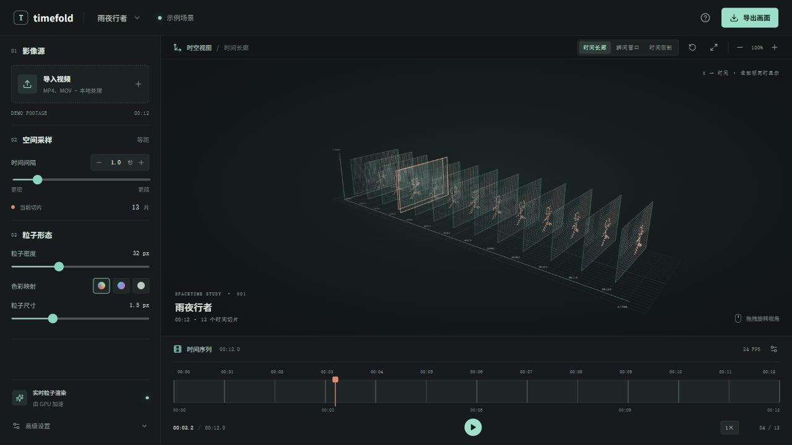

# Timefold

**Turn video into a walkable slice through time.**

Timefold samples a video into image planes, places those planes along the X axis by timestamp, and renders them as particles in a 3D scene. It is a small, browser-based experiment for exploring how motion looks when every moment can be seen at once. The current interface is in Simplified Chinese.

[简体中文](README.zh-CN.md)




## What it does

- Samples a local video at a configurable time interval and keeps all sampled frames in the scene.
- Maps each frame onto the YZ plane; X represents its timestamp.
- Converts image pixels into GPU-rendered points, with original, monochrome, and spectrum color modes.
- Highlights RGB changes between adjacent samples, and moves a scan plane with the playhead.
- Provides overview, frame-focused, and side-on camera views, plus drag rotation, wheel zoom, PNG export, and playback controls.

This is an interactive visualization, not a video editor or motion-tracking system. Frame highlighting uses pixel differences; it does not identify objects.

## Run locally

Requirements: Node.js `20.19+` and a browser with WebGL support. Clone the repository, then run these commands from the project directory:

```sh
cd Timefold
npm ci
npm run dev
```

Open the local URL printed by Vite, choose a video from your device, and adjust the sample interval. The included rainy-street scene works without importing a video.

```sh
npm test
npm run build
```

## How to explore

| Control | Action |
| --- | --- |
| Playhead or playback button | Move through time; every slice stays in the scene |
| Camera-view buttons | Switch between overview, frame focus, and side views |
| Drag the scene | Rotate the coordinate system |
| Scroll over the scene | Zoom the coordinate system |
| Particle controls | Change sampling density, point size, and color mapping |
| Export button | Save the current scene as a PNG |

## How it works

```text
Local video -> evenly spaced timestamps -> canvas frame sampling
            -> RGB pixel differences -> point geometry on YZ planes
            -> Three.js scene along X (time) -> browser renderer
```

The scene and frame-difference helpers live in `src/main.js` and `src/sampling.js`. Pure geometry and pixel helpers have Node test coverage in `src/*.test.js`.

## Privacy and limitations

Video frames are decoded and processed in the browser; this app has no upload service or backend. The interface currently loads its typefaces from Google Fonts. Playback depends on the browser being able to decode the selected video's codec. Dense sampling and high-resolution frames increase memory use and GPU work.

## Contributing

Bug reports, focused feature ideas, and pull requests are welcome. Read [CONTRIBUTING.md](CONTRIBUTING.md) before opening a pull request. Keep changes focused, run `npm test` and `npm run build`, and include a screenshot for visual changes.

## License

Timefold is released under the [MIT License](LICENSE).
